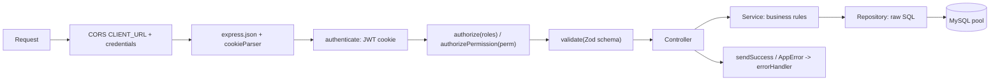

# StayCare Backend — Architecture

## Request lifecycle



## Folder layout

```
staycare_back/
├── api/index.ts            # serverless entry (legacy/Vercel-style; not used by Render)
├── src/
│   ├── app.ts              # Express app, CORS, routers, errorHandler
│   ├── server.ts           # local/Render bootstrap (dev DB init + pool check + listen)
│   ├── config/             # index.ts (env + validation), env.ts, swagger.ts
│   ├── routes/             # *.routes.ts
│   ├── controllers/        # *.controller.ts (+ Swagger JSDoc)
│   ├── services/           # *.service.ts (business logic)
│   ├── repositories/       # *.repository.ts (SQL)
│   ├── validation/         # *.validation.ts (Zod)
│   ├── middleware/         # authenticate, authorize, registerAuthGate, validate, errorHandler
│   ├── db/                 # pool.ts, transaction.ts, bootstrapDev.ts
│   ├── types/              # orderStatus.ts
│   ├── utils/              # AppError, jwt, paginate, response, mail, id, crypto, mysqlErrors
│   └── __tests__/          # mirrors src/ (controllers, repositories, services)
├── scripts/                # dev-db.js, schema-rbac.sql, seed-rbac.ts, migrations/*.sql
├── docs/                   # PROJECT_CONTEXT.md, ARCHITECTURE.md, migration/ (base schema)
├── http/                   # manual .http requests (not production)
├── tmp/                    # throw-away verification scripts
├── .agents/                # AI-agent rules, workflows and skills (versioned)
├── Dockerfile, docker-compose.yml
```

## Modules and API prefixes

| Prefix | Router | Notes |
| :-- | :-- | :-- |
| `/api/auth` | `auth.routes.ts` | login, refresh, logout, register (admin only), password reset |
| `/api/users` | `user.routes.ts` | admin/staff user management |
| `/api/clients` | `client.routes.ts` | client profiles, price list, custom roles, sub-users |
| `/api/properties` | `property.routes.ts` | client sites |
| `/api/orders` | `order.routes.ts` | CRUD, unified `PATCH /:id/status`, reschedule, reassign, receive, deliver, bulk, CSV export |
| `/api/routes` | `route.routes.ts` | route planning and stops |
| `/api/invoices` | `invoice.routes.ts` | invoicing and payments |
| `/api/items` | `item.routes.ts` | item catalogue |
| `/api/machines` | `machine.routes.ts` | plant machines |
| `/api/invitations` | `invitation.routes.ts` | invite-by-email registration |
| `/api/reports` | `report.routes.ts` | aggregations |
| `/api/health` | `health.routes.ts` | health check |

## Identity model

- `users` holds every account; `role` is an ENUM
  (`admin, staff, driver, operator, client`).
- `client_profiles` (1:1 with a `client` user) holds B2B data; `properties`
  belong to a client profile.
- There is no separate `clients` table. `/api/clients` works on
  `client_profiles + users + properties`.
- Sub-users: `users.parent_client_id` + custom `roles`/`permissions`.

## Environment variables

See `.env.example` (placeholders only). Required: `DB_HOST`, `DB_USER`,
`DB_PASSWORD`, `DB_NAME`, `JWT_ACCESS_SECRET`, `JWT_REFRESH_SECRET`.
Optional: `DB_PORT`, `DB_POOL_SIZE`, `DB_QUEUE_LIMIT`, `DB_CONNECT_TIMEOUT_MS`,
`PORT`, `NODE_ENV`, `CLIENT_URL`, token lifetimes, SMTP_*.
Missing required variables stop the process at startup.

## Commands

| Command | Purpose |
| :-- | :-- |
| `npm run dev` | ts-node-dev with reload |
| `npm run build` | `tsc` type-check + compile to `dist/` |
| `npm start` | run compiled `dist/server.js` |
| `npm test` / `npm run test:watch` | Vitest |
| `npm run db:create:dev` / `db:schema:dev` / `db:seed:dev` / `db:bootstrap:dev` | development-only DB helpers |
| `docker compose up --build -d` | local MySQL + backend |

## Deployment notes

- Production API runs on Render with an external MySQL (SSL on). The Docker
  setup is for local development only.
- CORS only allows `CLIENT_URL` with credentials; cross-site cookies require
  `secure` + `sameSite: 'none'` in production.
